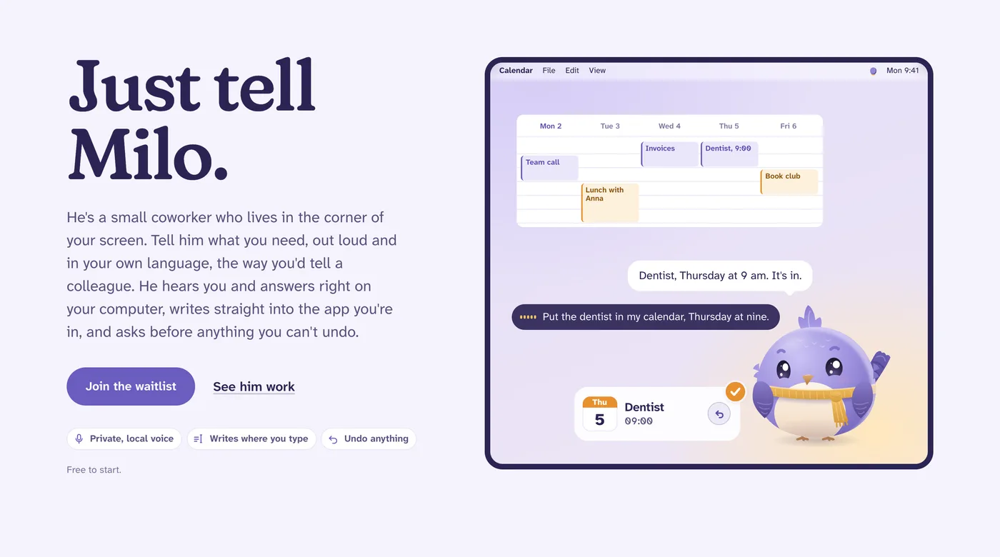
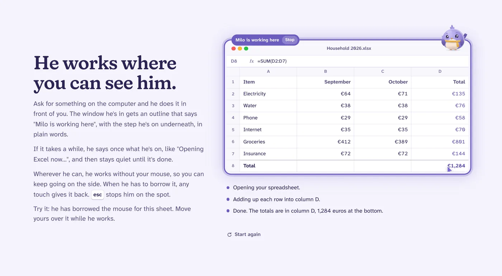
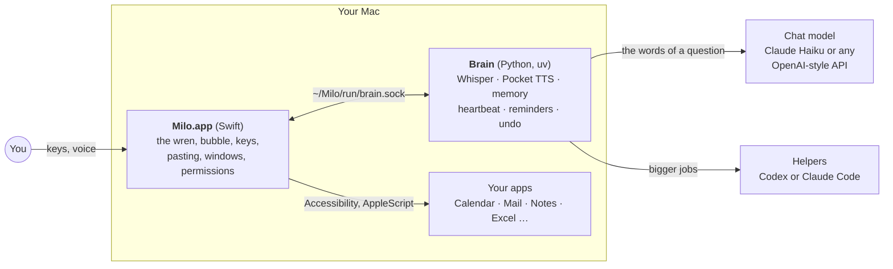

<p align="center">
  
</p>

<h1 align="center">Milo</h1>

<p align="center">
  <b>A small coworker who lives in the corner of your Mac.</b><br>
  Talk to him, dictate with him, hand him work, and watch him do it.
</p>

<p align="center">
  
  
  
  
</p>

<p align="center">
  <a href="https://nkls-ai.github.io/milo/"><b>Website</b></a> ·
  <a href="#what-he-does">What he does</a> ·
  <a href="#set-it-up">Set it up</a> ·
  <a href="#keys">Keys</a> ·
  <a href="#how-its-built">How it's built</a> ·
  <a href="#develop">Develop</a> ·
  <a href="docs/FEATURES.md">Every feature, in detail</a>
</p>

<picture>
  <source media="(prefers-color-scheme: dark)" srcset="assets/readme/hero-dark.webp">
  
</picture>

Hold a key and talk. Milo hears you **on your Mac**, answers out loud in a voice **made on your Mac**, and does the thing: a calendar entry, an email answer in the field you're typing in, a table in Excel. He asks before anything that can't be undone, and everything else comes with Undo.

Only the thinking goes out: the words of your question go to a chat model (Claude Haiku by default, or any OpenAI-style API, local ones included), and bigger jobs go to a helper agent (Codex or Claude Code). Your recordings never leave the Mac.

## What he does

### He writes where your cursor is

Click into a reply, hold right <kbd>⌥</kbd> and say *"answer Anna, Sunday works, but make it one"*. Milo looks at the email, writes the answer and pastes it straight into the field. No copying, no chatbot tab, no switching back. Nothing is sent: you read it and press Send. *"Undo that"* takes it out again.


### Fast, because hearing and speaking happen on your Mac

Whisper large-v3-turbo transcribes on the Apple GPU while you speak, so dictation is in your app **about half a second** after you let go (a second at most after a long one). His voice is Kyutai's **Pocket TTS** on the CPU, about **7x faster than real time**, sentence by sentence, in English and German. Dictation, his voice and reminders keep working offline.


### Small things take two seconds

Calendar entries, to-dos, timers, notes, mail drafts, music and your shortcuts happen right away, without a helper. A card springs out of him with a check and Undo, and you can still take a timer or a to-do back later.


<table>
  <tr>
    <td width="50%" valign="top">
      <b>He works where you can see him</b><br>
      Ask for something on the computer and he does it in front of you: his own pointer, an outline around the window, one plain line per step. <kbd>esc</kbd> stops him.<br><br>
      
    </td>
    <td width="50%" valign="top">
      <b>He asks before anything you can't undo</b><br>
      Sending, buying, money and deleting for good wait for your yes. Money only counts a click. The question stays open until you answer.<br><br>
      
    </td>
  </tr>
  <tr>
    <td width="50%" valign="top">
      <b>Several jobs at once</b><br>
      Small helper birds carry one job each while he keeps talking with you. Ask how far they've got, change a job, or stop one.<br><br>
      
    </td>
    <td width="50%" valign="top">
      <b>A memory you can read</b><br>
      He remembers your people, plans and how you like things, as plain files on your Mac. Fix what's wrong, or make him forget.<br><br>
      
    </td>
  </tr>
  <tr>
    <td width="50%" valign="top">
      <b>Meeting notes without a bot</b><br>
      When a call starts he asks once whether to take notes. Afterwards: a summary, decisions and to-dos ready for Reminders. Transcribed on your Mac.<br><br>
      
    </td>
    <td width="50%" valign="top">
      <b>And the small things that add up</b><br>
      Routines ("every Monday at nine"), <i>What's this?</i> on any selection, dictation that learns your names, hands-free talking, German and English.<br><br>
      
    </td>
  </tr>
</table>

Also: **message him from your phone** over Telegram ([setup](docs/setup/messages.md)), **look at my screen** when you ask (never on his own), and **opening things** ("YouTube in Chrome") while he's still saying so. Everything, with its settings: [docs/FEATURES.md](docs/FEATURES.md).

## Set it up

### One command

```sh
curl -fsSL https://nkls-ai.github.io/milo/install.sh | sh
```

Or `./install.sh` from a checkout. It takes a few minutes and asks one question:

1. **Checks the Mac** (Apple silicon, macOS 14+, 8 GB free) and installs Apple's Command Line Tools and [uv](https://docs.astral.sh/uv/) if they're missing, asking first.
2. **Installs the brain** and **downloads his ears, voice and memory**: Whisper, Pocket TTS and e5, all running on your Mac.
3. **Connects your subscription.** Claude (Pro or Max), ChatGPT (Plus or Pro), or both: it installs Claude Code or Codex if needed and opens the browser to log in. No API keys. Claude does the talking, so a ChatGPT-only setup can dictate and do jobs but can't talk yet.
4. **Builds the app**, puts it in Applications (a checkout keeps it in `build/`), offers to free the <kbd>fn</kbd> key, and starts Milo, who then asks for his three permissions.

Run it again to update. `--yes` asks nothing and connects only what's already logged in; `--no-app` installs the brain and models without the app. Linux and Windows get their own branch in the same script once their local hearing and voice exist.

### Let an agent do it

Open a coding agent (Claude Code, Codex or similar) in this folder and say:

> Set Milo up on this Mac.

[AGENTS.md](AGENTS.md) walks the agent through it: it checks the Mac, runs the installer, and tells you which logins and switches in System Settings only you can do.

### Or by hand

What the installer does, step by step. You need an Apple silicon Mac with macOS 14 or later, a few GB free for the speech models, and:

| What | Why | Get it |
|---|---|---|
| Xcode Command Line Tools | builds the Swift app | `xcode-select --install` |
| [uv](https://docs.astral.sh/uv/) | runs the Python brain | `curl -LsSf https://astral.sh/uv/install.sh \| sh` |
| [Claude Code](https://claude.com/claude-code), logged in | the chat model Milo talks with | `claude` once, then log in |
| [Codex](https://github.com/openai/codex), logged in | the helpers that do real work | `codex login`, or just have ChatGPT.app installed |

Prefer one provider? Set `[harness] use = "claude"` in `~/Milo/config.toml` and Claude Code does the helpers too. Or set `[chat] use = "openai_compat"` for OpenAI, OpenRouter, Ollama or LM Studio as the chat model.

```sh
git clone git@github.com:nkls-ai/milo.git && cd milo
cd brain && uv sync --extra omnivoice --extra pocket   # Python deps, about 1.5 GB
cd .. && scripts/make-signing-identity.sh              # once: macOS keeps Milo's permissions across rebuilds
scripts/build-app.sh --open                            # builds build/Milo.app and starts it
```

The first start downloads Whisper (about 1.8 GB with the live-words model) and the voice models to `~/.cache/huggingface`, then a setup window opens:

1. **Microphone**, **Accessibility** (keys, pasting, reading windows, using apps) and **Screen Recording** (looking when you ask). Each button opens the right switch with Milo already in the list. If he shows as on but gets no tick, press *Fix it*. Calendars, Reminders, Mail and Notes are optional. Open the window again any time with *Check permissions…* in the menu bar.
2. System Settings › Keyboard › "Press 🌐 key to" › **Do Nothing**, so <kbd>fn</kbd> belongs to Milo.
3. Quit Wispr Flow or any other dictation app that wants <kbd>fn</kbd>.

Settings are in the menu bar item › *Settings…*, and in `~/Milo/config.toml` for everything else (restart the brain from the menu bar after editing it by hand).

## Keys

| Key | What it does |
|---|---|
| hold <kbd>fn</kbd> | Dictate into any app. Let go and it's in. |
| double-tap <kbd>fn</kbd> | Dictate hands-free, up to 5 minutes. Tap once more to paste, <kbd>esc</kbd> to throw it away. |
| hold right <kbd>⌥</kbd> | Talk to Milo. Press it while he talks to stop him. |
| double-tap right <kbd>⌥</kbd> | Talk hands-free. |
| <kbd>esc</kbd> | Stop what he's doing on screen. |
| <kbd>⌃</kbd><kbd>⌥</kbd><kbd>M</kbd> | *What's this?* Explains the selection, or the whole window. |
| <kbd>⌃</kbd><kbd>⌥</kbd><kbd>N</kbd> | Start or stop meeting notes by hand. |

All of them can be changed in `[ui]` of `~/Milo/config.toml`.

## How it's built

Two processes on one Mac, talking JSON over a Unix socket ([ADR 1](docs/adr/0001-two-processes-over-a-unix-socket.md)):



- **`app/`** draws Milo and holds the macOS permissions. It knows nothing about models.
- **`brain/`** does the microphone, speech, the chat model, helpers, memory and the heartbeat. Engines are adapters picked in `config.toml`, so the core stays platform-neutral ([ADR 27](docs/adr/0027-a-platform-boundary.md)).
- **`~/Milo/`** is the workspace: settings, persona, memory, reminders, routines, logs. Plain files you can read.
- **`site/`** is the homepage: Astro on Bun, no tracking ([site/README.md](site/README.md)).

More in [docs/ARCHITECTURE.md](docs/ARCHITECTURE.md) and the [decisions](docs/adr/).

## Develop

Run the brain in a terminal and the app joins it instead of starting its own:

```sh
cd brain && uv run --extra omnivoice --extra pocket milo
```

Tests:

```sh
cd brain && uv run pytest -q
cd app && swift test
```

The dictation test plays recorded speech into a real brain on a throwaway workspace and fails on lost words or slow pastes (over 0.5 s after letting go, 1 s after more than 20 s of speech). `--fake` uses tones instead of voices and needs no models:

```sh
scripts/e2e-dictation.sh            # Whisper on macOS `say` voices, rendered to files; nothing plays
scripts/e2e-dictation.sh --fake
```

The 30-task eval runs Milo on a made-up calendar, inbox, notes and files and prints a score; it never touches your data ([tasks](docs/eval/tasks.md)). The on-screen eval runs real tasks on your real Mac with a second Milo.app, so run it only while you're away:

```sh
cd brain && uv run python -m milo.eval
cd brain && uv run python -m milo.eval.screen --only excel,numbers,file
```

`scripts/drive-milo.py "open YouTube in Chrome"` sends a typed turn to the running Milo and prints what he says and does, to check a change on the real Mac.

## Docs

- [Every feature, in detail](docs/FEATURES.md)
- [Architecture](docs/ARCHITECTURE.md): processes, ports and adapters, how to add an engine
- [Decisions](docs/adr/), [Roadmap](docs/ROADMAP.md), [Character](docs/CHARACTER.md), [Brand](docs/BRAND.md)
- [Message Milo from your phone](docs/setup/messages.md)
- [The 30-task eval](docs/eval/tasks.md)
- [Setup guide for agents](AGENTS.md)
