<p align="center">
  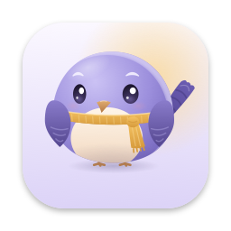
</p>

<h1 align="center">Milo</h1>

<p align="center">
  <b>A small coworker who lives in the corner of your screen.</b><br>
  Talk to him, dictate with him, hand him work, and watch him do it.<br>
  Free and open source. Native Mac app, shared Windows and Linux desktop.
</p>

<p align="center">
  
  
  
  
  
</p>

<p align="center">
  <a href="https://nkls-ai.github.io/milo/"><b>Website</b></a> ·
  <a href="#what-he-does">What he does</a> ·
  <a href="#plug-in-any-model">Plug in any model</a> ·
  <a href="#free">Free</a> ·
  <a href="#set-it-up">Set it up</a> ·
  <a href="#keys">Keys</a> ·
  <a href="#how-its-built">How it's built</a> ·
  <a href="#develop">Develop</a> ·
  <a href="docs/FEATURES.md">Every feature, in detail</a>
</p>

<p align="center">
  <a href="assets/readme/milo-demo.mp4"></a><br>
  <sub>The real Milo, drawn by the app's own code. <a href="assets/readme/milo-demo.mp4">Watch it with sound (MP4, 28 s)</a>.</sub>
</p>

<p align="center"><b>Speak it, it's there.</b> In your email, in any app, in your spreadsheet.</p>

Hold a key and talk. Milo hears you **on your computer**, answers out loud in a voice **made on your computer**, and does the thing: a calendar entry, an email answer in the field you're typing in, a table in Excel. He asks before anything that can't be undone, and everything else comes with Undo.

Only the thinking goes out: the words of your question go to a chat model (Claude Haiku by default, or any OpenAI-style API, local ones included), and bigger jobs go to a helper agent (Codex or Claude Code). Your recordings never leave your computer.

## What he does

### Speak it, it's there

Click into a reply, hold right <kbd>⌥</kbd> (Right <kbd>Alt</kbd> on Windows and Linux) and say *"write an email to Anna saying I'll be 10 minutes late"*, or *"answer Anna, Sunday works, but make it one"*. Milo writes it and pastes it straight into the field you were in. No copying, no chatbot tab, no switching back. Nothing is sent: you read it and press Send. *"Undo that"* takes it out again, and a field he mustn't touch (a password, a terminal) gets nothing: the text waits in his window to copy ([ADR 33](docs/adr/0033-milo-writes-where-you-are.md)).

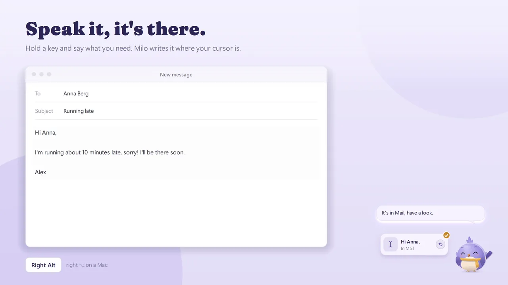

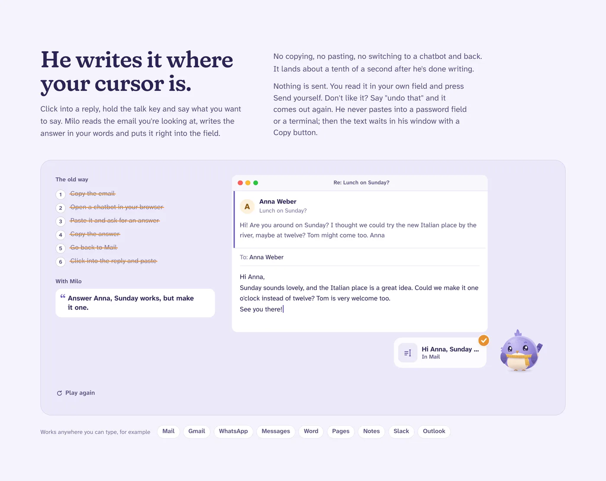

### Dictate into any app

Hold <kbd>fn</kbd> on a Mac (Right <kbd>Ctrl</kbd> on Windows and Linux), talk, let go: the text is in whatever app you're typing in. The ums and uhs are dropped, your clipboard is put back, and when you fix a word he got wrong ("Cloud Code" to "Claude Code"), he spells it your way next time. Double-tap for hands-free.

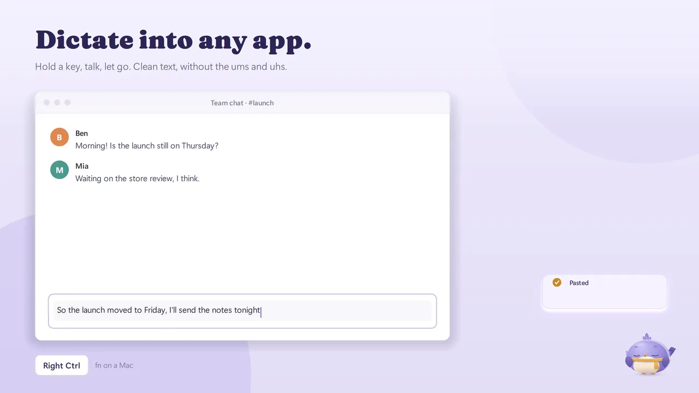

### Fast, because hearing and speaking happen on your computer

Whisper large-v3-turbo transcribes on the Apple GPU while you speak, so dictation is in your app **about half a second** after you let go (a second at most after a long one). His voice is Kyutai's **Pocket TTS** on the CPU, about **7x faster than real time**, sentence by sentence, in English and German. Dictation, his voice and reminders keep working offline.

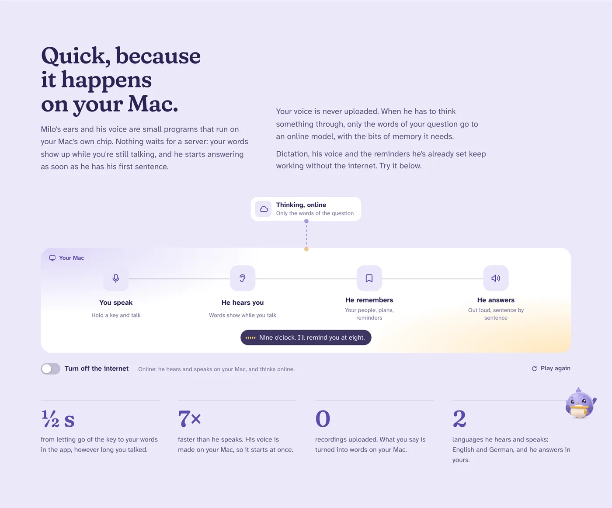

### He works where you can see him

Ask for something on the computer and he does it in front of you: his own pointer, an outline around the window, one plain line per step. Wherever he can, he works without your mouse. <kbd>esc</kbd> stops him, and what he changed comes with Undo ([ADR 26](docs/adr/0026-undo-what-a-task-did.md)).

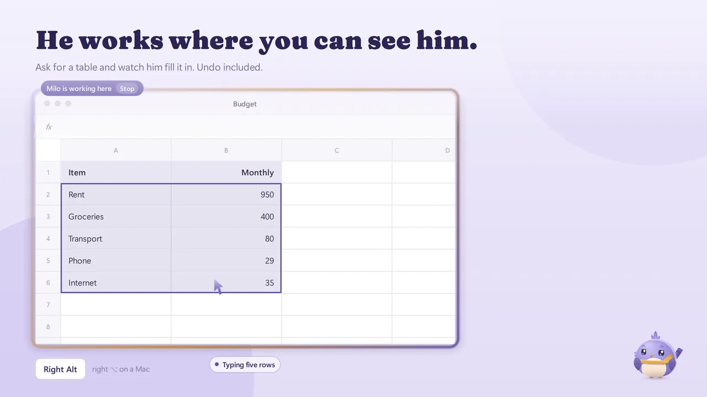

<table>
  <tr>
    <td width="50%" valign="top">
      <b>Small things take two seconds</b><br>
      Calendar entries, to-dos, timers, notes, mail drafts, music and your shortcuts happen right away, without a helper. A card springs out of him with a check and Undo, and you can still take a timer or a to-do back later.<br><br>
      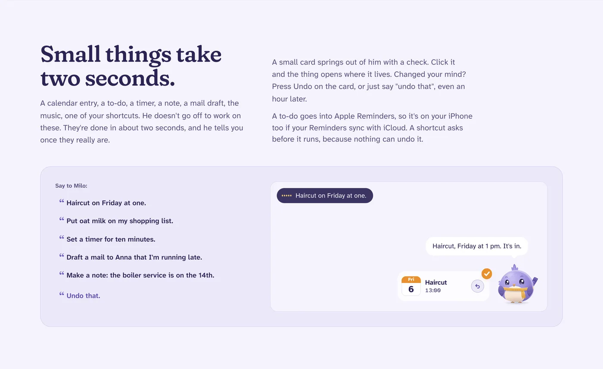
    </td>
    <td width="50%" valign="top">
      <b>He asks before anything you can't undo</b><br>
      Sending, buying, money and deleting for good wait for your yes. Money only counts a click. The question stays open until you answer.<br><br>
      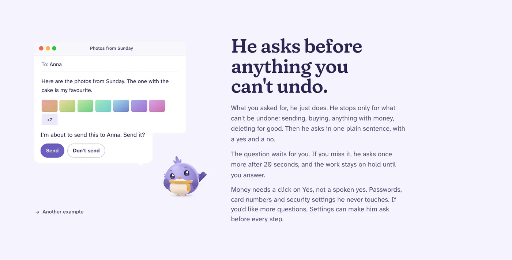
    </td>
  </tr>
  <tr>
    <td width="50%" valign="top">
      <b>Several jobs at once</b><br>
      Small helper birds carry one job each while he keeps talking with you. Ask how far they've got, change a job, or stop one.<br><br>
      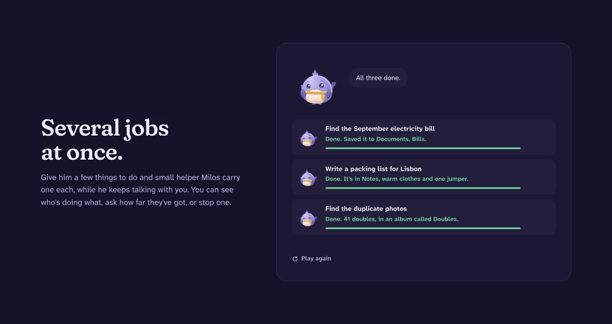
    </td>
    <td width="50%" valign="top">
      <b>A memory you can read</b><br>
      He remembers your people, plans and how you like things, as plain files on your computer. Fix what's wrong, or make him forget.<br><br>
      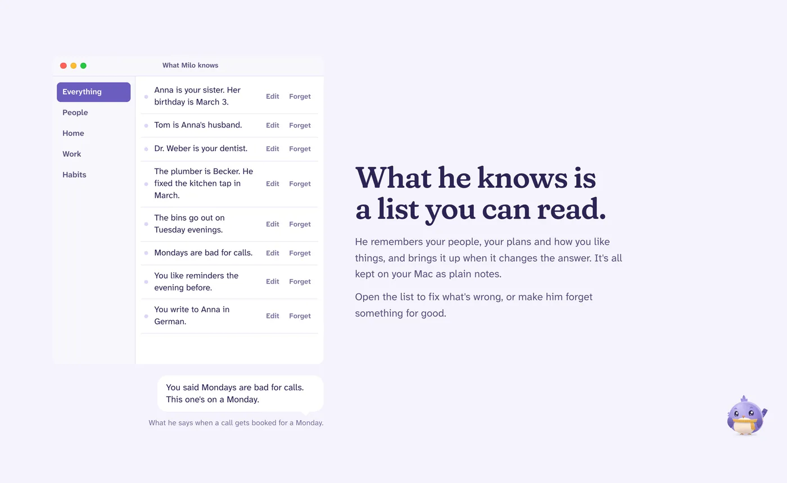
    </td>
  </tr>
  <tr>
    <td width="50%" valign="top">
      <b>Meeting notes without a bot</b><br>
      When a call starts he asks once whether to take notes. Afterwards: a summary, decisions and to-dos ready for Reminders. Transcribed on your computer.<br><br>
      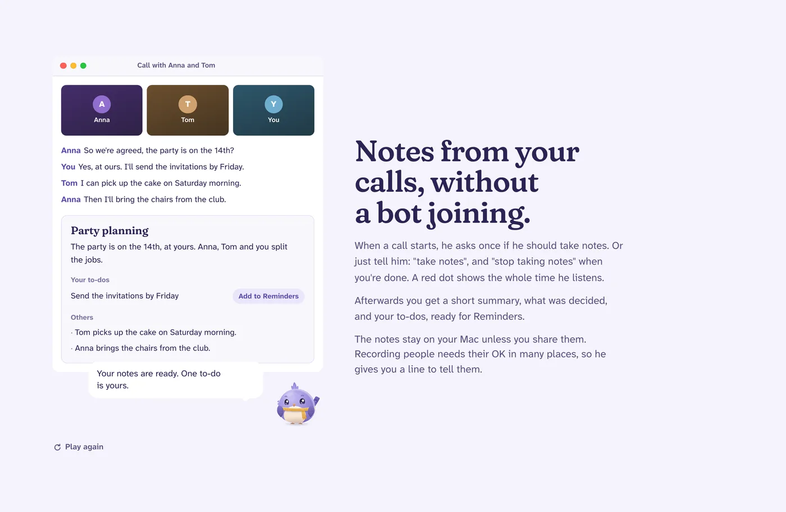
    </td>
    <td width="50%" valign="top">
      <b>And the small things that add up</b><br>
      Routines ("every Monday at nine"), <i>What's this?</i> on any selection, dictation that learns your names, hands-free talking, German and English.<br><br>
      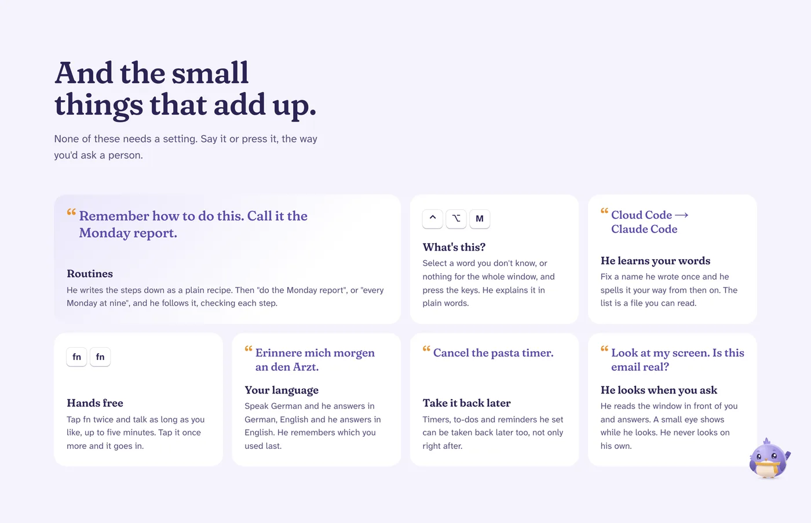
    </td>
  </tr>
</table>

Also: **message him from your phone** over Telegram ([setup](docs/setup/messages.md)), **look at my screen** when you ask (never on his own), and **opening things** ("YouTube in Chrome") while he's still saying so. Everything, with its settings: [docs/FEATURES.md](docs/FEATURES.md).

## Plug in any model

Milo talks through the model you already have, and the choice is yours on every platform:

| Talking through | What you need | Setting |
|---|---|---|
| **Claude** (the default, Claude Haiku) | a Claude Pro or Max login: `claude auth login` | `[chat] use = "claude_live"` |
| **Codex / ChatGPT** | a ChatGPT Plus or Pro login: `codex login` | `[chat] use = "codex_live"` |
| **Any OpenAI-compatible API**: Ollama, LM Studio, OpenAI, OpenRouter, Groq, or your own | a running local server, or an API key | `[chat] use = "openai_compat"` |

On **Windows and Linux**, pick it in **Setup › Connections & models**: under **Talking**, choose **OpenAI-compatible API or local server**, then a preset (Ollama, LM Studio, OpenAI, OpenRouter, Groq or Custom). A running Ollama or LM Studio is found by itself, with its models to click. A hosted preset takes a pasted API key, saved alone in `Milo/secrets/<file>`, never in `config.toml`. **Test** asks the model for one short reply and shows how long it took. More in [Plug in any model](docs/setup/windows-linux.md#plug-in-any-model).

On the **Mac**, it's a few lines in `~/Milo/config.toml` (then *Restart brain* in the menu bar):

```toml
[chat]
use = "openai_compat"

[chat.openai_compat]
base_url = "http://localhost:11434/v1"   # Ollama; LM Studio: http://localhost:1234/v1, OpenRouter: https://openrouter.ai/api/v1
model = "llama3.2"                       # a model your server has
key_ref = ""                             # for a hosted API, a file name in ~/Milo/secrets/, e.g. "openai.key"
```

The bigger jobs, the helpers that work in files, apps and the web, still run through Claude Code or Codex (`[harness] use = "claude"` or `"codex"`). Without either, Milo still talks and takes dictation.

## Free

Milo costs nothing and all of his code is here. You bring the model you already pay for or run yourself, and your recordings never leave your computer.

### Later: Milo with nothing to set up

This repo is all of Milo, free: you run him on your own computer with the subscription you already have. If enough people want it, a hosted version may follow, with nothing to install and no accounts to connect, the same Milo on all your devices and every model included, for one monthly price. Nothing is built yet. If you'd use it, say so on the [website](https://nkls-ai.github.io/milo/#get) or open an issue.

## Set it up

**Windows and Linux:** use the [desktop setup and build guide](docs/setup/windows-linux.md). It covers local speech, standalone bundles, native desktop controls, and current integration limits. [Outlook and CalDAV setup](docs/setup/desktop-connections.md) connects calendar, to-dos, mail and notes where supported.

The instructions below are for the native Mac app.

### One command

```sh
curl -fsSL https://nkls-ai.github.io/milo/install.sh | sh
```

Or `./install.sh` from a checkout. It takes a few minutes and asks one question:

1. **Checks the Mac** (Apple silicon, macOS 14+, 8 GB free) and installs Apple's Command Line Tools and [uv](https://docs.astral.sh/uv/) if they're missing, asking first.
2. **Installs the brain** and **downloads his ears, voice and memory**: Whisper, Pocket TTS and e5, all running on your Mac.
3. **Connects your subscription.** Claude (Pro or Max), ChatGPT (Plus or Pro), or both: it installs Claude Code or Codex if needed and opens the browser to log in. No API keys. Either Claude CLI or Codex CLI can talk and run helpers; the two choices are independent.
4. **Builds the app**, puts it in Applications (a checkout keeps it in `build/`), offers to free the <kbd>fn</kbd> key, and starts Milo, who then asks for his three permissions.

Run it again to update. `--yes` asks nothing and connects only what's already logged in; `--no-app` installs the brain and models without the app. Use the desktop guide above for Windows and Linux.

### Let an agent do it

Open a coding agent (Claude Code, Codex or similar) in this folder and say:

> Set Milo up on this Mac.

[AGENTS.md](AGENTS.md) walks the agent through it: it checks the Mac, runs the installer, and tells you which logins and switches in System Settings only you can do.

### Or by hand

What the installer does, step by step. You need an Apple silicon Mac with macOS 14 or later, a few GB free for the speech models, and:

| What | Why | Get it |
|---|---|---|
| Xcode Command Line Tools | builds the Swift app | `xcode-select --install` |
| [uv](https://docs.astral.sh/uv/) | runs the Python brain | `curl -LsSf https://astral.sh/uv/install.sh \| sh` |
| [Claude Code](https://claude.com/claude-code) and/or [Codex](https://github.com/openai/codex), logged in | the talking model and helpers | `claude auth login` or `codex login` in your own terminal |

Prefer one provider? For Codex talking and helpers, set `[chat] use = "codex_live"` and `[harness] use = "codex"` in `~/Milo/config.toml`. For Claude, use `"claude_live"` and `"claude"` respectively. Settings offers the talking-provider choice on all three platforms; restart the brain after changing it. Or set `[chat] use = "openai_compat"` for OpenAI, OpenRouter, Ollama or LM Studio as the chat model. API endpoint/model/key-file references live in `[chat.openai_compat]`; keys themselves stay in `~/Milo/secrets/`.

```sh
git clone git@github.com:nkls-ai/milo.git && cd milo
cd brain && uv sync --extra omnivoice --extra pocket   # Python deps, about 1.5 GB
cd .. && scripts/make-signing-identity.sh              # once: macOS keeps Milo's permissions across rebuilds
scripts/build-app.sh --open                            # builds build/Milo.app and starts it
```

The first start downloads Whisper (about 1.8 GB with the live-words model) and the voice models to `~/.cache/huggingface`, then a setup window opens:

1. **Microphone**, **Accessibility** (keys, pasting, reading windows, using apps) and **Screen Recording** (looking when you ask). Each button opens the right switch with Milo already in the list. If he shows as on but gets no tick, press *Fix it*. Calendars, Reminders, Mail and Notes are optional. Open the window again any time with *Check permissions…* in the menu bar.
2. System Settings › Keyboard › "Press 🌐 key to" › **Do Nothing**, so <kbd>fn</kbd> belongs to Milo.
3. Quit Wispr Flow or any other dictation app that wants <kbd>fn</kbd>.

Settings are in the menu bar item › *Settings…*, and in `~/Milo/config.toml` for everything else (restart the brain from the menu bar after editing it by hand).

## Keys

| Key | What it does |
|---|---|
| hold <kbd>fn</kbd> | Dictate into any app. Let go and it's in. |
| double-tap <kbd>fn</kbd> | Dictate hands-free, up to 5 minutes. Tap once more to paste, <kbd>esc</kbd> to throw it away. |
| hold right <kbd>⌥</kbd> | Talk to Milo. Press it while he talks to stop him. |
| double-tap right <kbd>⌥</kbd> | Talk hands-free. |
| <kbd>esc</kbd> | Stop what he's doing on screen. |
| <kbd>⌃</kbd><kbd>⌥</kbd><kbd>M</kbd> | *What's this?* Explains the selection, or the whole window. |
| <kbd>⌃</kbd><kbd>⌥</kbd><kbd>N</kbd> | Start or stop meeting notes by hand. |

All of them can be changed in `[ui]` of `~/Milo/config.toml`.

## How it's built

Two processes on one Mac, talking JSON over a Unix socket ([ADR 1](docs/adr/0001-two-processes-over-a-unix-socket.md)):

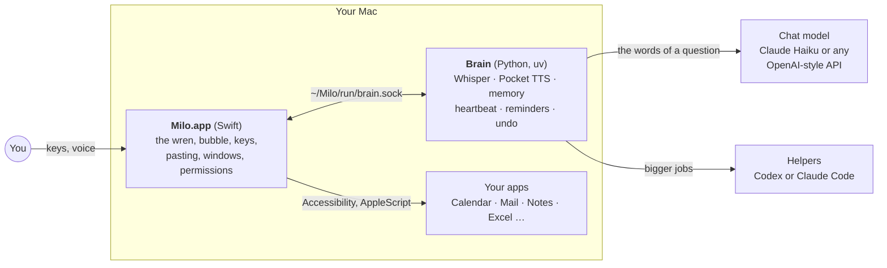

- **`app/`** draws Milo and holds the macOS permissions. It knows nothing about models.
- **`brain/`** does the microphone, speech, the chat model, helpers, memory and the heartbeat. Engines are adapters picked in `config.toml`, so the core stays platform-neutral ([ADR 27](docs/adr/0027-a-platform-boundary.md)).
- **`~/Milo/`** is the workspace: settings, persona, memory, reminders, routines, logs. Plain files you can read.
- **`site/`** is the homepage: Astro on Bun, no tracking ([site/README.md](site/README.md)).

More in [docs/ARCHITECTURE.md](docs/ARCHITECTURE.md) and the [decisions](docs/adr/).

## Develop

Run the brain in a terminal and the app joins it instead of starting its own:

```sh
cd brain && uv run --extra omnivoice --extra pocket milo
```

Tests:

```sh
cd brain && uv run pytest -q
cd app && swift test
```

The dictation test plays recorded speech into a real brain on a throwaway workspace and fails on lost words or slow pastes (over 0.5 s after letting go, 1 s after more than 20 s of speech). `--fake` uses tones instead of voices and needs no models:

```sh
scripts/e2e-dictation.sh            # Whisper on macOS `say` voices, rendered to files; nothing plays
scripts/e2e-dictation.sh --fake
```

The 30-task eval runs Milo on a made-up calendar, inbox, notes and files and prints a score; it never touches your data ([tasks](docs/eval/tasks.md)). The on-screen eval runs real tasks on your real Mac with a second Milo.app, so run it only while you're away:

```sh
cd brain && uv run python -m milo.eval
cd brain && uv run python -m milo.eval.screen --only excel,numbers,file
```

`scripts/drive-milo.py "open YouTube in Chrome"` sends a typed turn to the running Milo and prints what he says and does, to check a change on the real Mac.

## Docs

- [Every feature, in detail](docs/FEATURES.md)
- [Architecture](docs/ARCHITECTURE.md): processes, ports and adapters, how to add an engine
- [Decisions](docs/adr/), [Roadmap](docs/ROADMAP.md), [Character](docs/CHARACTER.md), [Brand](docs/BRAND.md)
- [Message Milo from your phone](docs/setup/messages.md)
- [The 30-task eval](docs/eval/tasks.md)
- [Setup guide for agents](AGENTS.md)

The film at the top is drawn by the app's own QML (the wren, his capsule, bubble, cards, outline and pointer) over plain, made-up windows. Music: "Happy Beats / Business Moves Vol. 10" by Sascha Ende, [ende.app](https://ende.app/en) ([CC BY 4.0](https://ende.app/en/standard-license)).
